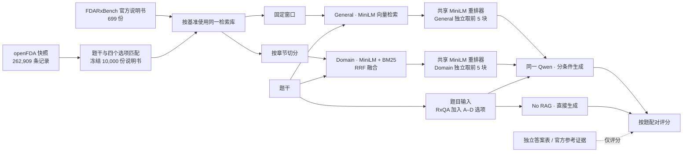

# Domain-Aware FDA Drug Label QA

MSBD 5018 · Group 18 · 2026-11-08 更新

本项目研究药品说明书的章节结构与混合检索能否改善问答。FDARxBench 衡量证据覆盖、短答和拒答，RxQA 衡量四选一准确率。

**FDARxBench 和 RxQA 主实验均已完成。** RxQA 的 300 道题由两款模型在三个条件下各答一遍，共 1,800 条预测，全部可解析。两位组员的独立人工盲评仍待完成。

[最终报告](report/Group18_Report_Final.pdf) · [答辩 PPT](presentation/Group18_Presentation_Final.pptx) · [正式结果](runs/step2-rxqa-20261107/) · [交接说明](HANDOFF.md)

## 1. 主要结果

### FDARxBench

| 指标 | No RAG | General RAG | Domain RAG |
|---|---:|---:|---:|
| Recall@5，60 道可答题 | — | 64.9% | 66.0% |
| Evidence80@5，60 道可答题 | — | 52.5% | **64.3%** |
| Qwen3.5 2B 短答 F1，20 道可答题 | 0.267 | 0.324 | 0.366 |
| Qwen3.5 4B 短答 F1，20 道可答题 | 0.167 | 0.394 | 0.421 |

Domain 相对 General 的 Evidence80@5 提高 **11.9 个百分点**，配对 95% 区间为 **+4.8 至 +20.0**。两个模型的短答 F1 差值区间均包含零。生成主表另有 10 道拒答题，单独统计。9B 在三款模型共享的 15 题子集上评估。

[检索结果](results/retrieval.json) · [检索配对区间](results/retrieval_paired.json) · [短答与拒答结果](results/answers/)

### openFDA × RxQA

| 模型 | No RAG | General RAG | Domain RAG |
|---|---:|---:|---:|
| Qwen3.5 2B | 33.7%（101/300） | 42.3%（127/300） | **43.0%（129/300）** |
| Qwen3.5 4B | 40.7%（122/300） | 61.0%（183/300） | **62.3%（187/300）** |

两种 RAG 相对 No RAG 的准确率差值区间均高于零。Domain 相对 General 的增量为 **2B +0.7 个百分点**（95% 区间 −3.7 至 +5.0）和 **4B +1.3 个百分点**（−2.3 至 +5.0），额外收益仍不确定。

[2B 分难度结果](runs/step2-rxqa-20261107/qwen-2b.metrics.json) · [4B 分难度结果](runs/step2-rxqa-20261107/qwen-4b.metrics.json) · [配对区间](runs/step2-rxqa-20261107/paired-accuracy.json)

## 2. 实验设计

| 条件 | 检索与生成 |
|---|---|
| No RAG | 直接回答。RxQA 同时提供 A–D 选项。 |
| General RAG | 展平说明书，固定窗口切分，使用 MiniLM 向量余弦检索，再重排。 |
| Domain RAG | 保留章节边界，在章节内切长段。用相同的向量检索与 BM25 各取前 20 名，经 RRF 融合，再重排。 |

- 两种切法的窗口上限均为 **160 个空白分隔词**，相邻窗口重叠 **24 词**。检索片段都加上药品名。
- 向量模型为 `sentence-transformers/all-MiniLM-L6-v2`。RRF 常数为 **60**，按 (1/(60+r)) 累加各路名次 (r) 的得分。
- 两种 RAG 共用 `cross-encoder/ms-marco-MiniLM-L6-v2`，重排前 **10** 个候选，给生成模型最多 **5** 个片段。检索查询只使用题干。同一模型的三个条件使用相同解码设置。
- FDARxBench 另外比较了章节切分、混合检索及重排。主结果衡量整套领域检索方案相对固定窗口基线的效果。消融见[报告](report/Group18_Report_Final.pdf)。

### 项目架构



### 数据范围与答案隔离

**FDARxBench 抽题，检索库使用基准内全部 699 份有效说明书。** 固定版本含 17,207 道题。用种子 5018 从事实、多跳、拒答各抽 30 题，检索指标使用其中 60 道可答题，2B 和 4B 的生成主实验使用每类 10 道。

**RxQA 保留全部 300 道题，检索库使用 openFDA 子集。** 从 2026-11-06 的 262,909 条快照记录中冻结 10,000 份说明书记录。这样能控制磁盘和内存用量，同时保留题目涉及的候选说明书及干扰记录。

| 构成 | 数量 | 选择依据 |
|---|---:|---|
| 核心标签 | 6,379 | 匹配题干、四个选项中的药品别名，并纳入与 FDARxBench `set_id` 对应的记录。 |
| 困难候选 | 2,000 | 从核心集以外选取仍匹配题干药品别名的记录。 |
| 固定背景 | 1,621 | 对其余记录按固定种子排序取样，补足 10,000 份。 |

前置脚本读取 CSV 的正确选项做一致性检查，再将答案单独保存。**选库用题干和全部选项，未使用正确选项标记。** 296 题在题干中找到精确药品别名，4 题仅在选项中找到。这个计数表示候选药品覆盖。RxQA 缺少逐题参考证据段落，因此无法从药名映射或答题结果确认具体证据是否入库。正式结果适用于这份按题目覆盖构建的固定子集。

[冻结选库清单](runs/step1-coverage-20261106-r2/subset_manifest.json) · [原始分卷与哈希](runs/step1-coverage-20261106-r2/source_manifest.json) · [Step 1 校验](runs/step1-coverage-20261106-r2/validation_report.json)

## 3. 指标与验证

| 指标 | 评分方式 |
|---|---|
| Recall@k | 对每题，计算前 k 块与参考证据词位置有重叠的参考段落比例。 |
| Evidence80@k | 对每题，计算至少 80% 参考词位置被前 k 块合计覆盖的参考段落比例。 |
| MRR@10 | 取第一次证据命中的排名倒数，前 10 无命中记零。 |
| 短答 EM / F1 | 对可答题计算归一化完全匹配和词重叠 F1。应拒答题和可答题误拒单列。 |
| RxQA accuracy | 正确选项数除以题数，按总体与四个难度分组汇报。无法解析的输出计错并单列。 |

配对比较先算同一题在两个条件下的分数差，再按题型或难度分层，以种子 5018 重抽 5,000 次得到 95% 区间。证据覆盖、答案正确性与引文是否支持主张是不同的评估维度。

## 4. 复现

### 复核已保存的 RxQA 结果

此步骤只需要 Python 3.12 和仓库中的小文件。脚本逐条核对冻结提示、原始输出、答案及分难度汇总，然后重算配对区间。

```sh
frozen=runs/step1-coverage-20261106-r2
run=runs/step2-rxqa-20261107
python3 scripts/summarize_rxqa.py "$frozen" "$run" | diff - "$run/paired-accuracy.json"
```

### 重跑 RxQA 生成

启动 Ollama，准备 `qwen3.5:2b` 与 `qwen3.5:4b`。原运行使用 Ollama 0.40.14，2B 为 MXFP8，4B 为 NVFP4。精确模型摘要见[运行清单](runs/step2-rxqa-20261107/model-manifest.json)。冻结提示已包含检索证据，可直接用于生成。自定义端口用 `--url` 指定。

```sh
frozen=runs/step1-coverage-20261106-r2
out=runs/step2-rxqa-reproduction
mkdir -p "$out"
for size in 2b 4b; do
  python3 openfda_rxqa.py evaluate \
    --input "$frozen/rxqa_prompts.jsonl" \
    --answer-key "$frozen/rxqa_answer_key.json" \
    --model "qwen3.5:$size" --out "$out/qwen-$size.jsonl"
done
python3 scripts/summarize_rxqa.py "$frozen" "$out" > "$out/paired-accuracy.json"
```

同一模型与提示可从相同的预测文件续跑。更换输入或模型时使用新输出目录。

### 重跑 FDARxBench

安装 `requirements.txt` 的检索依赖并启动 Ollama。需要 Apple Silicon 加速时按对应脚本的设备参数配置。

```sh
python3 -m pip install -r requirements.txt
git clone https://github.com/xiongbetty/FDARxBench.git
git -C FDARxBench checkout 019785d2802c4ceec583e4d4b82b902d7a8f9910

python3 experiment.py --data FDARxBench/data --out runs/dense
python3 experiment.py --data FDARxBench/data --out runs/rerank \
  --from-retrieval runs/dense --reranker cross-encoder/ms-marco-MiniLM-L6-v2

for size in 2b 4b; do
  python3 answer.py runs/rerank/retrieval.jsonl "runs/qwen-$size/predictions.jsonl" \
    --model "qwen3.5:$size" --systems no_rag general_rerank domain_rerank --per-task 10
done
python3 compare.py runs/rerank/retrieval.jsonl general_rerank domain_rerank
```

### 重建 openFDA 检索输入

仅在需要重建索引或重新检索时，准备 14 个 ZIP 分卷，并用[实际冻结快照的清单](runs/step1-coverage-20261106-r2/source_manifest.json)核对 SHA-256。以下命令使用冻结标签 ID，将新产物写到单独目录。在 CPU 上运行时省略 `--device mps`。

```sh
frozen=runs/step1-coverage-20261106-r2
out=runs/step1-index-reproduction
mkdir -p "$out"
python3 openfda_rxqa.py index --zip data/openfda/drug-label-*.json.zip \
  --selected-labels "$frozen/subset_manifest.json" --out "$out/index" \
  --device mps --encode-batch-size 32 --max-chunks 900000 --max-index-bytes 12884901888
python3 openfda_rxqa.py prepare --index "$out/index" --csv rxqa/rxqa_openfda.csv \
  --out "$out/rxqa_prompts.jsonl" --device mps --block-size 8192
```

本地下载包缺失的 SQLite 文件已重建。恢复版的文件哈希与原版不同，但数据库完整性、行数、FTS 查询和冻结提示中的 3,000 条证据引用均通过检查。交付 ZIP 包含冻结提示与逐题预测，大型索引和原始分卷从数据包另取。 [恢复记录](runs/step2-rxqa-20261107/index-recovery.json) · [九项验收](runs/step2-rxqa-20261107/recovered-index-validation.json)

## 5. 项目文件与剩余事项

| 路径 | 内容 |
|---|---|
| [experiment.py](experiment.py)、[answer.py](answer.py)、[compare.py](compare.py) | FDARxBench 检索、生成、评分和配对分析。 |
| [select_subset.py](select_subset.py)、[openfda_rxqa.py](openfda_rxqa.py) | 选库、索引、提示生成和选择题评估。 |
| [scripts/](scripts/) | Step 1 验收和 RxQA 正式结果复核。 |
| [results/](results/)、[正式 RxQA 运行](runs/step2-rxqa-20261107/) | FDARxBench、历史 RxQA 试跑、正式逐题预测和指标。 |
| [report/](report/)、[presentation/](presentation/) | LaTeX 源稿、正式报告和答辩稿。用 `cd report && latexmk -pdf main.tex` 复编报告。 |

**人工盲评待完成。** 两位组员分别给 6 道 FDARxBench 题的 18 条回答评分，收齐后再揭盲并汇总分歧。 [盲评说明](review/README.md) · [评分表](review/scorecard.csv)

数据与模型来源：[FDARxBench](https://github.com/xiongbetty/FDARxBench) · [RxQA](https://github.com/google-health/rxqa) · [openFDA Drug Labeling](https://open.fda.gov/apis/drug/label/) · [MiniLM 编码器](https://huggingface.co/sentence-transformers/all-MiniLM-L6-v2) · [MiniLM 重排器](https://huggingface.co/cross-encoder/ms-marco-MiniLM-L6-v2) · [Qwen3.5](https://ollama.com/library/qwen3.5)
